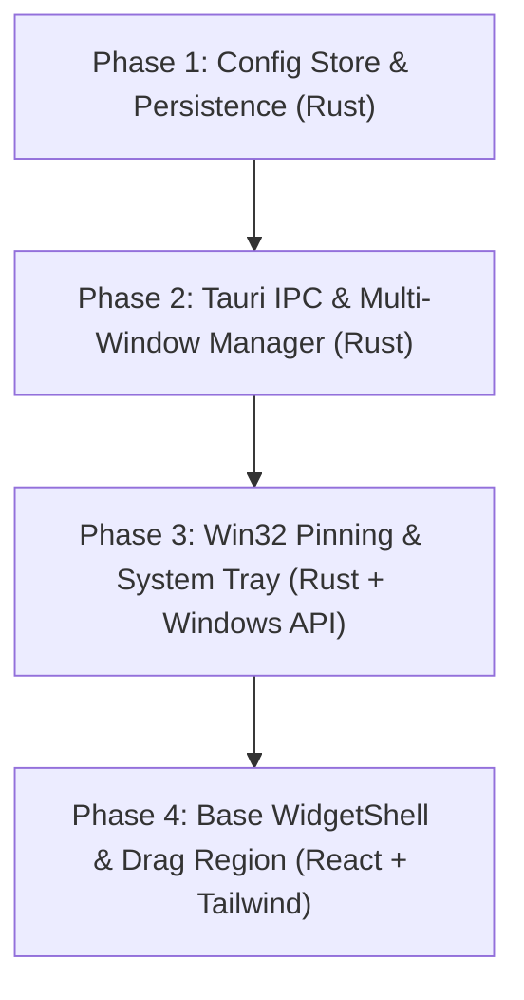

# Implementation Plan: Core Host Platform Engine (Phase 1)

> **Progress Tracker:** `[░░░░░░░░░░░░░░░░]` **0 / 20 Tasks Completed (0%)**

---

## 1. Overview & Architectural Scope

Dokumen ini adalah rencana kerja implementasi teknis untuk **Plan 1: Core Host Platform Engine**, yang diturunkan langsung dari Section 8.1 pada [`docs/srs/20261013_desktop_widget_platform.md`](file:///D:/Project%20Hub/my-widget/docs/srs/20261013_desktop_widget_platform.md) dan [`docs/prd/20261013_desktop_widget_platform.md`](file:///D:/Project%20Hub/my-widget/docs/prd/20261013_desktop_widget_platform.md).

Fokus utama rencana kerja ini adalah membangun fondasi aplikasi desktop berbasis Tauri v2 (Rust) yang stabil, ringan, dan terintegrasi langsung dengan API Windows:
1. Penyiapan scaffolding awal proyek gabungan Tauri v2, Rust host, React, Vite, dan Tailwind CSS.
2. Pengelolaan berkas konfigurasi lokal dan persistensi koordinat (X, Y) secara atomik di `%APPDATA%/my-widget/config.json`.
3. Manipulasi Win32 API (`windows-rs`) untuk menyematkan jendela di lapisan dasar desktop (`HWND_BOTTOM`), menyembunyikan dari taskbar (`skip_taskbar`), dan mengecualikan jendela dari pemilih `Alt + Tab` (`WS_EX_TOOLWINDOW`).
4. Kontrol menu ikon di System Tray Windows untuk mengelola penambahan dan penutupan jendela widget.
5. Pembuatan kontainer antarmuka dasar (*base widget shell*) dengan area pegangan geser (*drag handle*) berbasis atribut `data-tauri-drag-region`.

Seluruh implementasi dijalankan dengan pendekatan Test-Driven Development (TDD) yang ketat: setiap skenario perilaku dipecah menjadi sepasang commit atomik terpisah (`[TEST]` Red Phase dan `[FEAT]` Green Phase).

---

## Phase 1: Local Configuration Store & File Persistence (CONFIG)

Mengimplementasikan modul pembacaan, penulisan atomik, dan toleransi korupsi berkas konfigurasi koordinat jendela widget di `%APPDATA%/my-widget/config.json`.

### Scenario 1.1: Default Config Initialization when Config File is Missing (Normal Path / Boundary)
Memastikan sistem membuat konfigurasi default yang valid ketika aplikasi pertama kali dijalankan dan berkas konfigurasi lokal belum ada di direktori pengguna.
- [ ] **Task 1.1a: [TEST] Write failing test for initializing default config when file is missing**
  - **Fulfills**: `REQ-CONFIG-001`
  - **Files**: `[NEW] src-tauri/src/config/tests.rs`
  - **Commit**: `test(config): add failing test for default config initialization when file missing`
  - **Verification**: `cargo test config::tests::test_default_config_when_missing` (EXPECTED: FAIL / RED)

- [ ] **Task 1.1b: [FEAT] Implement ConfigStore and default instance creation**
  - **Fulfills**: `REQ-CONFIG-001`
  - **Files**: `[NEW] src-tauri/src/config/mod.rs`, `[NEW] src-tauri/src/config/models.rs`
  - **Commit**: `feat(config): implement ConfigStore with default instance coordinates`
  - **Verification**: `cargo test config::tests::test_default_config_when_missing` (EXPECTED: PASS / GREEN)

### Scenario 1.2: Atomic Persistence of Window Coordinates (Core Invariant / Normal Path)
Memastikan pembaruan posisi jendela (X, Y, Width, Height) disimpan ke disk secara atomik menggunakan penulisan berkas temporer untuk mencegah korupsi data akibat interupsi tiba-tiba.
- [ ] **Task 1.2a: [TEST] Write failing test for atomic coordinate persistence**
  - **Fulfills**: `REQ-CONFIG-001`
  - **Files**: `[MODIFY] src-tauri/src/config/tests.rs`
  - **Commit**: `test(config): add failing test for atomic window coordinate persistence`
  - **Verification**: `cargo test config::tests::test_save_window_position_atomic` (EXPECTED: FAIL / RED)

- [ ] **Task 1.2b: [FEAT] Implement atomic file write logic in ConfigStore**
  - **Fulfills**: `REQ-CONFIG-001`
  - **Files**: `[MODIFY] src-tauri/src/config/mod.rs`
  - **Commit**: `feat(config): implement atomic file write via temporary swap`
  - **Verification**: `cargo test config::tests::test_save_window_position_atomic` (EXPECTED: PASS / GREEN)

### Scenario 1.3: Corrupt Config Auto-Recovery (Error Path / Core Invariant)
Memastikan host engine tidak crash jika berkas `config.json` rusak atau terpotong, melainkan membuat cadangan berkas lama (*backup*) dan memuat konfigurasi default yang bersih.
- [ ] **Task 1.3a: [TEST] Write failing test for malformed config recovery**
  - **Fulfills**: `REQ-CONFIG-001`, `NFR-REL-002`
  - **Files**: `[MODIFY] src-tauri/src/config/tests.rs`
  - **Commit**: `test(config): add failing test for malformed config json recovery`
  - **Verification**: `cargo test config::tests::test_corrupt_config_auto_recovery` (EXPECTED: FAIL / RED)

- [ ] **Task 1.3b: [FEAT] Implement corruption backup and fallback recovery in ConfigStore**
  - **Fulfills**: `REQ-CONFIG-001`, `NFR-REL-002`
  - **Files**: `[MODIFY] src-tauri/src/config/mod.rs`
  - **Commit**: `feat(config): implement backup creation and fallback on malformed json`
  - **Verification**: `cargo test config::tests::test_corrupt_config_auto_recovery` (EXPECTED: PASS / GREEN)

---

## Phase 2: Tauri IPC Commands & Multi-Window Management (HOST)

Membangun jembatan komunikasi inter-proses (IPC) antara frontend dan backend Rust, serta pengendali siklus hidup jendela mandiri (*multi-window manager*).

### Scenario 2.1: IPC Commands for Config Query and Save (Normal Path)
Memverifikasi fungsi `cmd_load_window_config` dan `cmd_save_window_position` dapat dipanggil dari frontend dan mengembalikan payload yang benar sesuai kontrak SRS Section 3.2.
- [ ] **Task 2.1a: [TEST] Write failing test for config IPC command handlers**
  - **Fulfills**: `REQ-HOST-002`, `REQ-CONFIG-001`
  - **Files**: `[NEW] src-tauri/src/commands/tests.rs`
  - **Commit**: `test(commands): add failing test for load and save config IPC handlers`
  - **Verification**: `cargo test commands::tests::test_config_ipc_commands` (EXPECTED: FAIL / RED)

- [ ] **Task 2.1b: [FEAT] Implement cmd_load_window_config and cmd_save_window_position**
  - **Fulfills**: `REQ-HOST-002`, `REQ-CONFIG-001`
  - **Files**: `[NEW] src-tauri/src/commands/mod.rs`
  - **Commit**: `feat(commands): implement load and save config IPC handlers`
  - **Verification**: `cargo test commands::tests::test_config_ipc_commands` (EXPECTED: PASS / GREEN)

### Scenario 2.2: Window Manager Spawn and Instance Tracking (Normal Path / Boundary)
Memverifikasi pengendali jendela dapat meluncurkan jendela WebView2 baru dengan `instance_id` unik dan mencatat daftarnya di state aplikasi.
- [ ] **Task 2.2a: [TEST] Write failing test for WindowManager instance tracking**
  - **Fulfills**: `REQ-HOST-001`, ADR-003
  - **Files**: `[NEW] src-tauri/src/window/tests.rs`
  - **Commit**: `test(window): add failing test for window instance tracking and lifecycle`
  - **Verification**: `cargo test window::tests::test_window_manager_instance_tracking` (EXPECTED: FAIL / RED)

- [ ] **Task 2.2b: [FEAT] Implement WindowManager state and window spawn builder**
  - **Fulfills**: `REQ-HOST-001`, ADR-003
  - **Files**: `[NEW] src-tauri/src/window/mod.rs`, `[MODIFY] src-tauri/src/commands/mod.rs`
  - **Commit**: `feat(window): implement WindowManager for multi-window instance tracking`
  - **Verification**: `cargo test window::tests::test_window_manager_instance_tracking` (EXPECTED: PASS / GREEN)

### Scenario 2.3: Rejection of Invalid Coordinate Bounds or Non-Existent Instance Close (Boundary / Error Path)
Memastikan perintah penutupan jendela atau pemindahan koordinat memvalidasi argumen input dan mengembalikan error terstruktur jika instance tidak ditemukan atau koordinat berada di luar batas layar yang wajar.
- [ ] **Task 2.3a: [TEST] Write failing test for invalid coordinate bounds and unknown instance rejection**
  - **Fulfills**: `REQ-HOST-001`, `REQ-CONFIG-001`
  - **Files**: `[MODIFY] src-tauri/src/commands/tests.rs`
  - **Commit**: `test(commands): add failing test for invalid coordinates and unknown instance close`
  - **Verification**: `cargo test commands::tests::test_boundary_and_error_handling` (EXPECTED: FAIL / RED)

- [ ] **Task 2.3b: [FEAT] Implement boundary checks and error responses in commands**
  - **Fulfills**: `REQ-HOST-001`, `REQ-CONFIG-001`
  - **Files**: `[MODIFY] src-tauri/src/commands/mod.rs`
  - **Commit**: `feat(commands): add bounds validation and error handling for window commands`
  - **Verification**: `cargo test commands::tests::test_boundary_and_error_handling` (EXPECTED: PASS / GREEN)

---

## Phase 3: Win32 Desktop Pinning & System Tray Controller (WIN32 / TRAY)

Mengintegrasikan interop Win32 API untuk penempelan ke lapisan wallpaper desktop dan penyembunyian jendela dari taskbar/Alt+Tab, serta menu konteks System Tray.

### Scenario 3.1: Win32 Desktop Pinning and Extended Styles (Normal Path / Core Invariant)
Memastikan setiap jendela yang dibuat menerima atribut `WS_EX_TOOLWINDOW` dan ditempatkan pada lapisan Z-Order paling dasar (`HWND_BOTTOM`) melalui Win32 `SetWindowPos`.
- [ ] **Task 3.1a: [TEST] Write failing integration test verifying Win32 styles and pinning flags**
  - **Fulfills**: `REQ-HOST-001`
  - **Files**: `[NEW] src-tauri/src/platform/windows/tests.rs`
  - **Commit**: `test(platform): add failing test for Win32 desktop pinning and extended styles`
  - **Verification**: `cargo test platform::windows::tests::test_desktop_pinning_flags` (EXPECTED: FAIL / RED)

- [ ] **Task 3.1b: [FEAT] Implement Win32 pin_to_desktop via windows-rs**
  - **Fulfills**: `REQ-HOST-001`
  - **Files**: `[NEW] src-tauri/src/platform/windows/mod.rs`, `[MODIFY] src-tauri/Cargo.toml`
  - **Commit**: `feat(platform): implement Win32 HWND_BOTTOM pinning and toolwindow style`
  - **Verification**: `cargo test platform::windows::tests::test_desktop_pinning_flags` (EXPECTED: PASS / GREEN)

### Scenario 3.2: System Tray Registration and Event Handling (Normal Path)
Memastikan ikon System Tray terdaftar pada area notifikasi Windows dan menangani aksi klik menu ("Add Widget", "Reset All Positions", "Quit") dengan benar.
- [ ] **Task 3.2a: [TEST] Write failing test for System Tray menu builder and event router**
  - **Fulfills**: `REQ-HOST-003`
  - **Files**: `[NEW] src-tauri/src/tray/tests.rs`
  - **Commit**: `test(tray): add failing test for tray menu generation and action routing`
  - **Verification**: `cargo test tray::tests::test_tray_menu_routing` (EXPECTED: FAIL / RED)

- [ ] **Task 3.2b: [FEAT] Implement System Tray controller and event dispatch**
  - **Fulfills**: `REQ-HOST-003`
  - **Files**: `[NEW] src-tauri/src/tray/mod.rs`, `[MODIFY] src-tauri/src/main.rs`
  - **Commit**: `feat(tray): implement system tray menu builder and event listener`
  - **Verification**: `cargo test tray::tests::test_tray_menu_routing` (EXPECTED: PASS / GREEN)

---

## Phase 4: Base Frontend Widget Shell & Drag Region Contract (FRONTEND)

Membangun fondasi antarmuka web (React + Vite + Tailwind CSS) untuk membungkus jendela widget dengan pegangan geser (*drag handle*) dan verifikasi visual kaca buram (*frosted glass*).

### Scenario 4.1: Drag Region Attribute and Position Save Dispatch (Normal Path / Core Invariant)
Memastikan elemen pegangan geser di DOM memiliki atribut `data-tauri-drag-region` dan memicu IPC command `cmd_save_window_position` saat event mouseup terjadi.
- [ ] **Task 4.1a: [TEST] Write failing component test for drag handle attributes and IPC dispatch**
  - **Fulfills**: `REQ-HOST-002`
  - **Files**: `[NEW] src/components/WidgetShell.test.tsx`
  - **Commit**: `test(ui): add failing test for WidgetShell drag handle and save dispatch`
  - **Verification**: `pnpm test src/components/WidgetShell.test.tsx` (EXPECTED: FAIL / RED)

- [ ] **Task 4.1b: [FEAT] Implement WidgetShell component with drag region contract**
  - **Fulfills**: `REQ-HOST-002`
  - **Files**: `[NEW] src/components/WidgetShell.tsx`
  - **Commit**: `feat(ui): implement base WidgetShell container with drag region handler`
  - **Verification**: `pnpm test src/components/WidgetShell.test.tsx` (EXPECTED: PASS / GREEN)

### Scenario 4.2: Visual Shell Baseline Verification (Frosted Glass & Frameless Transparency)
Memverifikasi bahwa jendela shell merender latar belakang transparan dengan efek kaca buram (*frosted glass / backdrop-blur*) tanpa dekorasi jendela bawaan OS.
- [ ] **Task 4.2a: [TEST] Set up automated visual audit harness for transparent window shell**
  - **Fulfills**: Section 6.2 PRD
  - **Files**: `[NEW] tests/visual/widget-shell.visual.spec.ts`
  - **Commit**: `test(visual): add Playwright visual regression harness for WidgetShell`
  - **Verification**: `pnpm exec playwright test tests/visual/widget-shell.visual.spec.ts` (EXPECTED: FAIL / RED)

- [ ] **Task 4.2b: [FEAT] Configure Tailwind frosted glass styling and verify visual rendering**
  - **Fulfills**: Section 6.2 PRD
  - **Files**: `[MODIFY] src/components/WidgetShell.tsx`, `[MODIFY] src/index.css`, `[MODIFY] tailwind.config.js`
  - **Commit**: `feat(ui): configure translucent frosted glass styling for WidgetShell`
  - **Verification**: `/design` visual test via isolated `UI Visual Auditor` subagent across 4 visual dimensions (Core, Edge, Error, Invariant) on desktop (1280px) and widget viewport (320px x 450px) Playwright captures (EXPECTED: PASS & CERTIFIED)

---

## 2. Dependencies & Execution Sequence

1. **Rust Toolchain**: `stable-x86_64-pc-windows-msvc`.
2. **Node.js Environment**: Node v20+ dengan `pnpm`.
3. **Crates**: `tauri` (v2), `serde`, `serde_json`, `windows` (Win32 interop), `tempfile`.
4. **Frontend Packages**: `react`, `react-dom`, `@tauri-apps/api`, `tailwindcss`, `vite`, `@testing-library/react`, `vitest`, `@playwright/test`.
