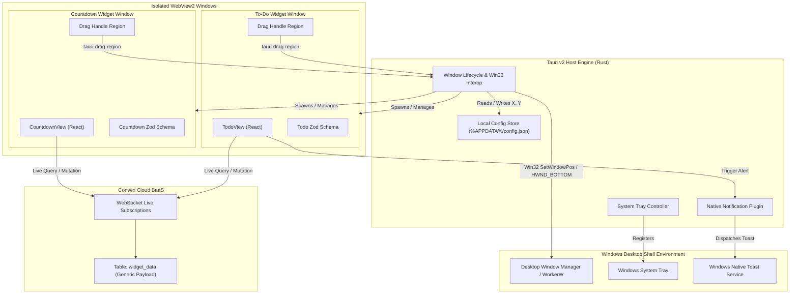

# Software Requirements Specification: Desktop Widget Platform

## Section 1: Metadata, Versioning & Traceability

- **Document ID**: `SRS-MYWIDGET-001`
- **Specification Version**: `v1.0.0`
- **Parent PRD**: [`docs/prd/20261013_desktop_widget_platform.md`](file:///C:/Users/Dimas%20Edra%20Ar%20Rafi/ProjectHub/my-widget/docs/prd/20261013_desktop_widget_platform.md)
- **Status**: Waiting for Review
- **Author**: Antigravity & Eds (System Engineering)
- **Traceability Baseline**: Memetakan seluruh kebutuhan fungsional dari PRD menjadi kontrak teknis yang dapat diuji secara otomatis *(automated test verification)*.

---

## Section 2: System Overview & Architectural Context

### 2.1 Scope & Context
Sistem `my-widget` adalah platform desktop multi-jendela berbasis Tauri v2 (Rust) yang berjalan di sistem operasi Windows. Platform ini memuat modul widget antarmuka berbasis web (React + Vite + Tailwind CSS) di dalam jendela WebView2 yang disematkan langsung di atas permukaan desktop Windows (`HWND_BOTTOM`), tanpa dekorasi jendela konvensional, serta terhubung secara reaktif ke basis data cloud Convex.

### 2.2 System Architecture Diagram



---

## Section 3: External Interface Requirements

### 3.1 Win32 Window Interop Contracts
1. **Window Properties**:
   - `decorations = false` (tanpa title bar, minimize, maximize, close buttons bawaan OS).
   - `transparent = true` (latar belakang jendela transparan dengan per-pixel alpha channel).
   - `skip_taskbar = true` (tidak menampilkan ikon pada taskbar utama Windows).
2. **Extended Window Styles (`GWL_EXSTYLE`)**:
   - Menerapkan flag `WS_EX_TOOLWINDOW` (`0x00000080`) agar jendela tidak muncul dalam pemilih jendela `Alt + Tab`.
   - Mengatur penempatan Z-Order pada lapisan paling dasar menggunakan `SetWindowPos(hwnd, HWND_BOTTOM, ...)`.

### 3.2 Inter-Process Communication (IPC) Commands (Frontend <-> Rust)
- `cmd_save_window_position(instance_id: String, x: i32, y: i32, width: u32, height: u32) -> Result<(), String>`
- `cmd_load_window_config() -> Result<AppConfig, String>`
- `cmd_trigger_native_notification(title: String, body: String) -> Result<(), String>`
- `cmd_open_widget(widget_type: String) -> Result<String, String>`
- `cmd_close_widget(instance_id: String) -> Result<(), String>`

### 3.3 Convex Communication Protocol
- Protokol komunikasi: WebSocket terenkripsi (`wss://`) menggunakan pustaka resmi `@convex-dev/react`.
- Operasi baca: Reaktif live queries via `useQuery(api.widgets.get, { instanceId })`.
- Operasi tulis: Mutasi asinkron via `useMutation(api.widgets.updatePayload)`.

---

## Section 4: Functional Requirements (System Capabilities)

### Module 1: Host Engine & Windowing (HOST)

#### REQ-HOST-001: Desktop Window Pinning
- **Inputs & Preconditions**: Jendela widget diinisialisasi oleh Tauri engine.
- **Processing & Logic**:
  1. Rust mengambil handler jendela native (`HWND`).
  2. Rust menyetel properti gaya jendela extended ke `WS_EX_TOOLWINDOW`.
  3. Rust memanggil `SetWindowPos` dengan parameter `HWND_BOTTOM` dan flag `SWP_NOSIZE | SWP_NOMOVE | SWP_NOACTIVATE`.
- **Outputs**: Jendela berada di atas wallpaper desktop, tidak menutupi jendela aplikasi lain, dan tidak terlihat di taskbar maupun menu `Alt + Tab`.
- **Failure Modes**: Jika panggilan Win32 gagal, sistem mencatat peringatan di log dan tetap menampilkan jendela tanpa dekorasi.

#### REQ-HOST-002: Custom Drag Handle Interaction
- **Inputs & Preconditions**: Pengguna menekan tombol kiri mouse pada elemen DOM dengan atribut `data-tauri-drag-region`.
- **Processing & Logic**:
  1. WebView2 menangkap event mouse down pada elemen drag handle.
  2. Tauri runtime mengambil alih perpindahan jendela mengikuti koordinat kursor mouse pengguna secara native.
  3. Saat event mouse up terjadi, frontend memanggil `cmd_save_window_position` dengan koordinat terkini.
- **Outputs**: Posisi jendela berpindah lancar di monitor dan koordinat baru tercatat di memori dan penyimpanan lokal.

#### REQ-HOST-003: System Tray Controller
- **Inputs & Preconditions**: Aplikasi host dimulai.
- **Processing & Logic**:
  1. Rust mendaftarkan ikon aplikasi ke area notifikasi taskbar Windows *(System Tray)*.
  2. Menyediakan menu konteks klik kanan:
     - "Add Widget" -> Submenu menampilkan daftar widget terdaftar (`todo`, `countdown`).
     - "Reset All Positions" -> Mengembalikan koordinat semua widget ke titik default.
     - "Quit" -> Menutup seluruh proses host dan jendela anak.
- **Outputs**: Ikon interaktif aktif di tray Windows.

---

### Module 2: Local Configuration Persistence (CONFIG)

#### REQ-CONFIG-001: Local Position Persistence
- **Inputs & Preconditions**: Permintaan penyimpanan posisi dari event perpindahan jendela (`cmd_save_window_position`).
- **Processing & Logic**:
  1. Rust membaca berkas `%APPDATA%/my-widget/config.json`.
  2. Rust memperbarui nilai `x`, `y`, `width`, `height` untuk `instance_id` terkait.
  3. Menulis ulang berkas JSON secara atomik menggunakan penulisan berkas temporer *(atomic write)* untuk mencegah korupsi data jika listrik padam tiba-tiba.
- **Outputs**: Berkas konfigurasi lokal berhasil diperbarui.
- **Failure Modes**: Jika direktori `%APPDATA%/my-widget` belum ada, Rust membuatnya secara otomatis.

---

### Module 3: Cloud Synchronization & Data Contract (SYNC)

#### REQ-SYNC-001: Generic Polymorphic Payload Storage (Pola A)
- **Inputs & Preconditions**: Klien widget mengirim payload mutasi baru.
- **Processing & Logic**:
  1. Mutasi Convex `updatePayload` menerima argumen `{ instanceId, widgetType, payload }`.
  2. Convex memeriksa keberadaan baris pada tabel `widget_data` berdasarkan indeks `by_instance`.
  3. Jika baris sudah ada, perbarui `payload` dan setel `updatedAt = Date.now()`. Jika belum ada, lakukan `insert`.
  4. Server Convex secara otomatis menyiarkan hasil kueri terbaru ke semua klien yang berlangganan pada `instanceId` tersebut.
- **Outputs**: Data tersimpan di Convex dan semua klien terhubung menerima data termutasi secara instan.
- **Failure Modes**: Jika jaringan terputus, mutasi diantrikan di sisi klien sampai koneksi pulih kembali.

---

### Module 4: To-Do List Widget (TODO)

#### REQ-TODO-001: To-Do Payload Schema Validation
- **Inputs & Preconditions**: Payload diterima dari kueri Convex atau input pengguna.
- **Processing & Logic**:
  1. Validasi struktur menggunakan Zod schema `TodoPayloadSchema`:
     - `items`: array objek yang berisi:
       - `id`: string unik.
       - `text`: string (minimal 1 karakter, maksimal 500 karakter).
       - `isCompleted`: boolean.
       - `dueDate`: number opsional (epoch timestamp milidetik).
       - `notified`: boolean default `false`.
- **Outputs**: Objek TypeScript bertipe aman *(type-safe)*.
- **Failure Modes**: Jika payload tidak valid (korup), fallback ke struktur daftar kosong `{ items: [] }` dan catat error ke log konsol.

#### REQ-TODO-002: Task Mutation Operations
- **Inputs & Preconditions**: Pengguna berinteraksi dengan daftar to-do (menambah, mengubah status checklist, menghapus).
- **Processing & Logic**:
  1. Klien membuat salinan array `items` yang telah dimodifikasi.
  2. Klien memvalidasi salinan array tersebut melalui `TodoPayloadSchema`.
  3. Memanggil mutasi Convex `updatePayload` dengan data baru.
- **Outputs**: Item tugas diperbarui secara reaktif di antarmuka widget.

---

### Module 5: Days-To-Go Countdown Widget (COUNTDOWN)

#### REQ-COUNTDOWN-001: Countdown Payload Validation & Calculation
- **Inputs & Preconditions**: Payload countdown dimuat dari Convex.
- **Processing & Logic**:
  1. Validasi via Zod schema `CountdownPayloadSchema`:
     - `title`: string (maksimal 100 karakter).
     - `targetDate`: number (epoch timestamp milidetik).
     - `unit`: enum (`"days"` | `"hours"` | `"auto"`).
  2. Komponen UI menghitung selisih waktu: `deltaMs = targetDate - Date.now()`.
  3. Jika `deltaMs > 0`, konversi ke hari (`Math.floor(deltaMs / (1000 * 60 * 60 * 24))`).
  4. Jika `deltaMs <= 0`, tampilkan teks indikator event telah tiba (*"Today!"* atau *"Passed"*).
- **Outputs**: Tampilan angka hitung mundur yang akurat dan terhitung otomatis.

---

### Module 6: Notification Engine (NOTIF)

#### REQ-NOTIF-001: Due Date Threshold Monitoring & Toast Trigger
- **Inputs & Preconditions**: Widget To-Do aktif memiliki item dengan `dueDate` yang belum bertanda `notified = true`.
- **Processing & Logic**:
  1. Interval timer (setiap 30 detik) memeriksa item tugas aktif.
  2. Jika `item.dueDate <= Date.now()` dan `item.isCompleted == false` dan `item.notified == false`:
     - Panggil `cmd_trigger_native_notification` dengan judul *"Tugas Mencapai Batas Waktu"* dan isi teks tugas.
     - Lakukan mutasi ke Convex untuk menandai `notified: true` pada item tersebut agar notifikasi tidak terpicu ganda.
- **Outputs**: Banner toast native Windows muncul di layar pengguna dengan audio notifikasi sistem.

---

## Section 5: Non-Functional Requirements (NFRs)

### 5.1 Performance & Resource Limits
- **NFR-PERF-001 (RAM Footprint)**: Total konsumsi RAM keseluruhan proses (Host Engine Rust + 2 jendela WebView2) tidak boleh melebihi 90 MB saat dalam status diam *(idle)*.
- **NFR-PERF-002 (CPU Usage)**: Penggunaan CPU pada kondisi diam harus 0.0% (tidak ada timer animasi yang terus-menerus membebani GPU/CPU).
- **NFR-PERF-003 (Startup Latency)**: Waktu dari aplikasi dijalankan hingga jendela widget pertama muncul di layar kurang dari 1.5 detik pada spesifikasi SSD modern.

### 5.2 Reliability & Error Recovery
- **NFR-REL-001 (Offline Resilience)**: Jika koneksi internet terputus, aplikasi tidak boleh crash atau menampilkan layar putih error; aplikasi harus tetap menampilkan snapshot data terakhir yang ada di memori.
- **NFR-REL-002 (Config Corrupt Immunity)**: Jika berkas `%APPDATA%/my-widget/config.json` rusak atau tidak valid JSON, host engine harus membuat cadangan berkas lama dan menginisialisasi konfigurasi baru dengan posisi default tanpa crash.

---

## Section 6: Data Models & Schema Specifications

### 6.1 Convex Cloud Schema (`convex/schema.ts`)
```typescript
import { defineSchema, defineTable } from "convex/server";
import { v } from "convex/values";

export default defineSchema({
  widget_data: defineTable({
    instanceId: v.string(),
    widgetType: v.string(), // "todo" | "countdown"
    title: v.string(),
    payload: v.any(),       // divalidasi per-widget di client
    updatedAt: v.number(),
  }).index("by_instance", ["instanceId"])
    .index("by_type", ["widgetType"]),
});
```

### 6.2 Local Host Configuration Schema (`%APPDATA%/my-widget/config.json`)
```json
{
  "version": 1,
  "instances": {
    "todo_default": {
      "widgetType": "todo",
      "x": 100,
      "y": 150,
      "width": 320,
      "height": 450,
      "visible": true
    },
    "countdown_default": {
      "widgetType": "countdown",
      "x": 1400,
      "y": 150,
      "width": 280,
      "height": 200,
      "visible": true
    }
  }
}
```

---

## Section 7: Verification Matrix, Constraints & Dependencies

### 7.1 Automated Verification Matrix

| Requirement ID | Deskripsi Kebutuhan | Strategi Verifikasi | Target Kriteria Lolos |
| :--- | :--- | :--- | :--- |
| **REQ-HOST-001** | Desktop Pinning (`HWND_BOTTOM`) | Integration Test (Rust) | Panggilan Win32 mengembalikan kode sukses tanpa error privilege. |
| **REQ-HOST-002** | Custom Drag Handle | Contract / Unit Test | Elemen handle memiliki atribut drag region dan memicu IPC save. |
| **REQ-HOST-003** | System Tray Controller | Integration Test (Rust) | Menu tray terdaftar dan menangani event aksi dengan benar. |
| **REQ-CONFIG-001**| Local Config Persistence | Unit Test (Rust) | Berkas JSON berhasil ditulis, dibaca, dan tahan uji berkas korup. |
| **REQ-SYNC-001** | Generic Payload Convex | Contract Test (TS) | Mutasi menyimpan data dan kueri mengembalikan data yang sama. |
| **REQ-TODO-001** | To-Do Zod Schema | Unit Test (TS) | Zod memvalidasi payload valid dan menolak payload malformed. |
| **REQ-TODO-002** | Task Mutation Ops | Unit Test (TS) | State tugas bertambah, berkurang, dan toggle secara deterministik. |
| **REQ-COUNTDOWN-001** | Countdown Zod & Logic | Unit Test (TS) | Perhitungan selisih hari akurat terhadap mock epoch time. |
| **REQ-NOTIF-001**| Due Date Toast Trigger | Unit Test (TS) | Event notifikasi terpicu tepat saat timestamp melewati batas waktu. |

### 7.2 Dependencies & Prerequisites
- **Rust Toolchain**: `stable-x86_64-pc-windows-msvc` (Rust 1.75+).
- **Node.js**: v20+ dengan pnpm atau npm.
- **Tauri CLI**: `v2.x`.
- **Convex Client**: `convex@1.x`.
- **Windows SDK**: Termasuk header C++ / Win32 untuk kompilasi `windows-rs`.
