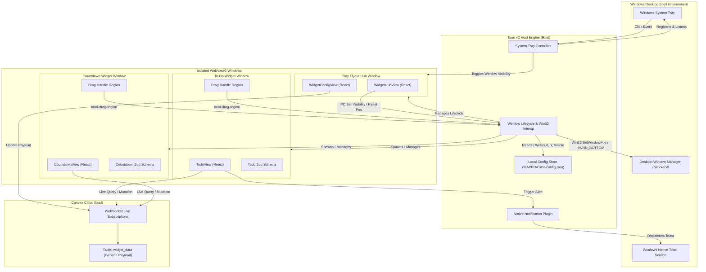

# Software Requirements Specification: Desktop Widget Platform

## Section 1: Metadata, Versioning & Traceability

- **Document ID**: `SRS-MYWIDGET-001`
- **Specification Version**: `v1.1.0`
- **Parent PRD**: [`docs/prd/20261013_desktop_widget_platform.md`](file:///D:/Project%20Hub/my-widget/docs/prd/20261013_desktop_widget_platform.md)
- **Status**: Approved
- **Author**: Antigravity & Eds (System Engineering)
- **Traceability Baseline**: Memetakan seluruh kebutuhan fungsional dari PRD menjadi kontrak teknis yang dapat diuji secara otomatis *(automated test verification)*.

---

## Section 2: System Overview & Architectural Context

### 2.1 Scope & Context
Sistem `my-widget` adalah platform desktop multi-jendela berbasis Tauri v2 (Rust) yang berjalan di sistem operasi Windows. Platform ini memuat modul widget antarmuka berbasis web (React + Vite + Tailwind CSS) di dalam jendela WebView2 yang disematkan langsung di atas permukaan desktop Windows (`HWND_BOTTOM`), tanpa dekorasi jendela konvensional, serta terhubung secara reaktif ke basis data cloud Convex.

Selain jendela widget di desktop, platform menyediakan **Tray Flyout Hub** (antarmuka pop-up kompak di area taskbar tray) sebagai pusat navigasi visual utama bagi pengguna untuk mengelola status widget (tampil/sembunyi), menambah instance widget baru, mengonfigurasi parameter masing-masing widget (judul, target waktu, preferensi notifikasi), serta memulihkan koordinat widget.

### 2.2 System Architecture Diagram



---

## Section 3: External Interface Requirements

### 3.1 Win32 Window Interop Contracts
1. **Desktop Widget Windows**:
   - `decorations = false` (tanpa title bar, minimize, maximize, close buttons bawaan OS).
   - `transparent = true` (latar belakang jendela transparan dengan per-pixel alpha channel).
   - `skip_taskbar = true` (tidak menampilkan ikon pada taskbar utama Windows).
   - Flag extended `WS_EX_TOOLWINDOW` (`0x00000080`) agar jendela tidak muncul dalam `Alt + Tab`.
   - Z-Order lapisan paling dasar via `SetWindowPos(hwnd, HWND_BOTTOM, ...)`.
2. **Tray Flyout Hub Window**:
   - `decorations = false`, `transparent = true`, `skip_taskbar = true`.
   - `always_on_top = true` saat aktif agar melayang di atas jendela aplikasi biasa ketika dibuka dari tray.
   - Perilaku penutupan jendela: jendela tetap terbuka secara persisten dan ditutup secara eksplisit via tombol tutup (close button 'X') pada antarmuka flyout atau melalui klik ulang pada ikon system tray.

### 3.2 Inter-Process Communication (IPC) Commands (Frontend <-> Rust)
- `cmd_save_window_position(instance_id: String, x: i32, y: i32, width: u32, height: u32) -> Result<(), String>`
- `cmd_load_window_config() -> Result<AppConfig, String>`
- `cmd_trigger_native_notification(title: String, body: String) -> Result<(), String>`
- `cmd_open_widget(widget_type: String) -> Result<String, String>`
- `cmd_close_widget(instance_id: String) -> Result<(), String>`
- `cmd_toggle_flyout() -> Result<(), String>`
- `cmd_set_widget_visibility(instance_id: String, visible: bool) -> Result<(), String>`
- `cmd_reset_widget_position(instance_id: String) -> Result<(), String>`

### 3.3 Convex Communication Protocol
- Protokol komunikasi: WebSocket terenkripsi (`wss://`) menggunakan pustaka resmi `@convex-dev/react`.
- Operasi baca: Reaktif live queries via `useQuery(api.widgets.get, { instanceId })`.
- Operasi tulis: Mutasi asinkron via `useMutation(api.widgets.updatePayload)`.

### 3.4 Visual Design & Styling Contract (Mono Gray Minimalist Theme)
1. **Design Theme & Color Tokens**:
   - Skema warna primer: *Monochrome Gray* modern, ramping *(sleek)*, dan minimalis.
   - Background canvas: `#0a0a0a` (`neutral-950`).
   - Surface & Card Container: `#171717` (`neutral-900`) dengan border tipis `#262626` (`neutral-800`).
   - Accent & Active Highlights: `#e5e5e5` (`neutral-200`) dan `#ffffff`.
   - Typography Text: Primary text `#f5f5f5` (`neutral-100`), Secondary / Muted text `#a3a3a3` (`neutral-400`).
2. **Visual Texture & Ergonomics**:
   - Translucent glass effect: `backdrop-blur-md` dengan opasitas permukaan seimbang untuk keterbacaan tinggi di atas wallpaper desktop maupun latar gelap taskbar.
   - Zero decorative visual clutter: menghilangkan elemen ornamen berlebih; memprioritaskan tipografi bersih, kontras terukur, dan kontrol aksi yang padat ringkas *(high density)*.

---

## Section 4: Functional Requirements (System Capabilities)

### Module 1: Host Engine & Windowing (HOST)

#### REQ-HOST-001: Desktop Window Pinning
- **Inputs & Preconditions**: Jendela widget diinisialisasi oleh Tauri engine.
- **Processing & Logic**:
  1. Rust mengambil handler jendela native (`HWND`).
  2. Rust menyetel properti gaya jendela extended ke `WS_EX_TOOLWINDOW`.
  3. Rust memanggil `SetWindowPos` dengan parameter `HWND_BOTTOM` dan flag `SWP_NOSIZE | SWP_NOMOVE | SWP_NOACTIVATE`.
- **Outputs**: Jendela berada di atas wallpaper desktop, tidak menutupi jendela aplikasi lain, dan tidak terlihat di taskbar maupun menu `Alt + Tab`.
- **Failure Modes**: Jika panggilan Win32 gagal, sistem mencatat peringatan di log dan tetap menampilkan jendela tanpa dekorasi.

#### REQ-HOST-002: Custom Drag Handle Interaction
- **Inputs & Preconditions**: Pengguna menekan tombol kiri mouse pada elemen DOM dengan atribut `data-tauri-drag-region`.
- **Processing & Logic**:
  1. WebView2 menangkap event mouse down pada elemen drag handle.
  2. Tauri runtime mengambil alih perpindahan jendela mengikuti koordinat kursor mouse pengguna secara native.
  3. Saat event mouse up terjadi, frontend memanggil `cmd_save_window_position` dengan koordinat terkini.
- **Outputs**: Posisi jendela berpindah lancar di monitor dan koordinat baru tercatat di memori dan penyimpanan lokal.

#### REQ-HOST-003: System Tray Controller
- **Inputs & Preconditions**: Aplikasi host dimulai.
- **Processing & Logic**:
  1. Rust mendaftarkan ikon aplikasi ke area notifikasi taskbar Windows *(System Tray)*.
  2. Menangani event klik kiri (`MouseButton::Left`): memanggil `cmd_toggle_flyout` untuk menampilkan atau menyembunyikan jendela Tray Flyout Hub di atas area tray.
  3. Menyediakan menu konteks klik kanan sebagai kontrol cepat fallback:
     - "Open Hub" -> Membuka jendela Tray Flyout Hub.
     - "Reset All Positions" -> Mengembalikan koordinat semua widget ke titik default.
     - "Quit" -> Menutup seluruh proses host dan jendela anak.
- **Outputs**: Ikon interaktif aktif di tray Windows dengan kemampuan toggle antarmuka visual hub.

---

### Module 2: Local Configuration Persistence (CONFIG)

#### REQ-CONFIG-001: Local Position Persistence
- **Inputs & Preconditions**: Permintaan penyimpanan posisi dari event perpindahan jendela (`cmd_save_window_position`).
- **Processing & Logic**:
  1. Rust membaca berkas `%APPDATA%/my-widget/config.json`.
  2. Rust memperbarui nilai `x`, `y`, `width`, `height` untuk `instance_id` terkait.
  3. Menulis ulang berkas JSON secara atomik menggunakan penulisan berkas temporer *(atomic write)* untuk mencegah korupsi data jika listrik padam tiba-tiba.
- **Outputs**: Berkas konfigurasi lokal berhasil diperbarui.
- **Failure Modes**: Jika direktori `%APPDATA%/my-widget` belum ada, Rust membuatnya secara otomatis.

---

### Module 3: Cloud Synchronization & Data Contract (SYNC)

#### REQ-SYNC-001: Generic Polymorphic Payload Storage (Pola A)
- **Inputs & Preconditions**: Klien widget mengirim payload mutasi baru.
- **Processing & Logic**:
  1. Mutasi Convex `updatePayload` menerima argumen `{ instanceId, widgetType, payload }`.
  2. Convex memeriksa keberadaan baris pada tabel `widget_data` berdasarkan indeks `by_instance`.
  3. Jika baris sudah ada, perbarui `payload` dan setel `updatedAt = Date.now()`. Jika belum ada, lakukan `insert`.
  4. Server Convex secara otomatis menyiarkan hasil kueri terbaru ke semua klien yang berlangganan pada `instanceId` tersebut.
- **Outputs**: Data tersimpan di Convex dan semua klien terhubung menerima data termutasi secara instan.
- **Failure Modes**: Jika jaringan terputus, mutasi diantrikan di sisi klien sampai koneksi pulih kembali.

---

### Module 4: To-Do List Widget (TODO)

#### REQ-TODO-001: To-Do Payload Schema Validation
- **Inputs & Preconditions**: Payload diterima dari kueri Convex atau input pengguna.
- **Processing & Logic**:
  1. Validasi struktur menggunakan Zod schema `TodoPayloadSchema`:
     - `items`: array objek yang berisi:
       - `id`: string unik.
       - `text`: string (minimal 1 karakter, maksimal 500 karakter).
       - `isCompleted`: boolean.
       - `dueDate`: number opsional (epoch timestamp milidetik).
       - `notified`: boolean default `false`.
- **Outputs**: Objek TypeScript bertipe aman *(type-safe)*.
- **Failure Modes**: Jika payload tidak valid (korup), fallback ke struktur daftar kosong `{ items: [] }` dan catat error ke log konsol.

#### REQ-TODO-002: Task Mutation Operations
- **Inputs & Preconditions**: Pengguna berinteraksi dengan daftar to-do (menambah, mengubah status checklist, menghapus).
- **Processing & Logic**:
  1. Klien membuat salinan array `items` yang telah dimodifikasi.
  2. Klien memvalidasi salinan array tersebut melalui `TodoPayloadSchema`.
  3. Memanggil mutasi Convex `updatePayload` dengan data baru.
- **Outputs**: Item tugas diperbarui secara reaktif di antarmuka widget.

---

### Module 5: Days-To-Go Countdown Widget (COUNTDOWN)

#### REQ-COUNTDOWN-001: Countdown Payload Validation & Calculation
- **Inputs & Preconditions**: Payload countdown dimuat dari Convex.
- **Processing & Logic**:
  1. Validasi via Zod schema `CountdownPayloadSchema`:
     - `title`: string (maksimal 100 karakter).
     - `targetDate`: number (epoch timestamp milidetik).
     - `unit`: enum (`"days"` | `"hours"` | `"auto"`).
  2. Komponen UI menghitung selisih waktu: `deltaMs = targetDate - Date.now()`.
  3. Jika `deltaMs > 0`, konversi ke hari (`Math.floor(deltaMs / (1000 * 60 * 60 * 24))`).
  4. Jika `deltaMs <= 0`, tampilkan teks indikator event telah tiba (*"Today!"* atau *"Passed"*).
- **Outputs**: Tampilan angka hitung mundur yang akurat dan terhitung otomatis.

---

### Module 6: Notification Engine (NOTIF)

#### REQ-NOTIF-001: Due Date Threshold Monitoring & Toast Trigger
- **Inputs & Preconditions**: Widget To-Do aktif memiliki item dengan `dueDate` yang belum bertanda `notified = true`.
- **Processing & Logic**:
  1. Interval timer (setiap 30 detik) memeriksa item tugas aktif.
  2. Jika `item.dueDate <= Date.now()` dan `item.isCompleted == false` dan `item.notified == false`:
     - Panggil `cmd_trigger_native_notification` dengan judul *"Tugas Mencapai Batas Waktu"* dan isi teks tugas.
     - Lakukan mutasi ke Convex untuk menandai `notified: true` pada item tersebut agar notifikasi tidak terpicu ganda.
- **Outputs**: Banner toast native Windows muncul di layar pengguna dengan audio notifikasi sistem.

---

### Module 7: Tray Flyout & Widget Management Hub (FLYOUT)

#### REQ-FLYOUT-001: Tray Flyout Window Lifecycle & Positioning
- **Inputs & Preconditions**: Pengguna mengklik ikon aplikasi di system tray Windows (`cmd_toggle_flyout`).
- **Processing & Logic**:
  1. Host Rust memeriksa status jendela flyout (`flyout`):
     - Jika jendela sedang terlihat (`is_visible() == true`), panggil `hide()`.
     - Jika jendela tersembunyi:
       a. Ambil koordinat kursor atau batas layar monitor utama.
       b. Hitung posisi jangkar sudut kanan bawah tepat di atas taskbar Windows (lebar 340px, tinggi 460px).
       c. Setel koordinat posisi via `set_position`, pastikan `always_on_top = true` dan `skip_taskbar = true`.
       d. Tampilkan jendela via `show()` dan berikan fokus via `set_focus()`.
  2. Jendela flyout menyediakan kontrol tombol tutup eksplisit (close button 'X' pada header antarmuka) yang memicu IPC untuk menyembunyikan jendela (`hide()`), serta dapat ditutup kembali dengan mengklik ulang ikon system tray.
- **Outputs**: Jendela pop-up flyout muncul mulus di atas taskbar, tetap terbuka secara persisten, dan hanya menutup ketika pengguna menekan tombol close ('X') atau mengklik ikon tray.
- **Failure Modes**: Jika dimensi monitor tidak terbaca, fallback ke koordinat layar default dengan margin aman 16px dari batas monitor.

#### REQ-FLYOUT-002: Widget Hub & Visibility Management View
- **Inputs & Preconditions**: Jendela flyout aktif dan menampilkan antarmuka React berbasis tema mono gray.
- **Processing & Logic**:
  1. Komponen `WidgetHubView` memuat konfigurasi lokal via `cmd_load_window_config` dan status sinkronisasi Convex (`LiveSync`).
  2. Menampilkan header dengan indikator status koneksi Convex (Online / Offline).
  3. Menampilkan daftar kartu instans widget aktif (`todo_default`, `countdown_default`):
     - Judul kustom dan badge tipe widget.
     - Sakelar toggle visibilitas (`visible: boolean`): saat status dialihkan, panggil IPC `cmd_set_widget_visibility(instanceId, visible)` untuk memanggil `show()` atau `hide()` pada jendela desktop target, serta memperbarui nilai `visible` di `config.json`.
     - Tombol "Settings" untuk beralih ke form konfigurasi in-place (`WidgetConfigView`).
  4. Menyediakan tombol "Add Widget" untuk menambahkan instans widget jika belum terbuka.
  5. Menyediakan kontrol global footer: "Reset All Positions" (`cmd_load_window_config` reset) dan "Quit".
- **Outputs**: Antarmuka kontrol terpusat untuk mengelola seluruh widget desktop.

#### REQ-FLYOUT-003: In-Place Widget Configuration & Sync Dispatch
- **Inputs & Preconditions**: Pengguna mengklik tombol "Settings" pada kartu widget di `WidgetHubView`.
- **Processing & Logic**:
  1. Antarmuka beralih tampilan ke `WidgetConfigView` dengan transisi mulus di dalam jendela flyout yang sama.
  2. Formulir menyajikan kolom pengaturan berdasarkan tipe widget:
     - Parameter umum: Input teks judul (`title`), tombol "Reset Posisi Widget Ini" (`cmd_reset_widget_position(instanceId)`).
     - Countdown spesifik: Pemilih tanggal target (`targetDate`), unit perhitungan (`"days"` | `"hours"` | `"auto"`).
     - To-Do spesifik: Pengaturan default waktu tenggat (`dueTime`) dan opsi pengingat notifikasi desktop.
  3. Saat pengguna menekan "Save":
     - Validasi data input menggunakan Zod schema terkait (`CountdownPayloadSchema` atau `TodoPayloadSchema`).
     - Jalankan mutasi Convex `updatePayload({ instanceId, widgetType, payload })` untuk memperbarui data cloud secara real-time.
     - Kembalikan tampilan flyout ke `WidgetHubView`.
- **Outputs**: Konfigurasi widget tersimpan ke Convex dan diterapkan langsung ke tampilan widget di desktop.
- **Failure Modes**: Jika validasi Zod gagal, form menampilkan pesan kesalahan validasi lokal tanpa menutup form atau memicu mutasi.

---

## Section 5: Non-Functional Requirements (NFRs)

### 5.1 Performance & Resource Limits
- **NFR-PERF-001 (RAM Footprint)**: Total konsumsi RAM keseluruhan proses (Host Engine Rust + 2 jendela WebView2) tidak boleh melebihi 90 MB saat dalam status diam *(idle)*.
- **NFR-PERF-002 (CPU Usage)**: Penggunaan CPU pada kondisi diam harus 0.0% (tidak ada timer animasi yang terus-menerus membebani GPU/CPU).
- **NFR-PERF-003 (Startup Latency)**: Waktu dari aplikasi dijalankan hingga jendela widget pertama muncul di layar kurang dari 1.5 detik pada spesifikasi SSD modern.

### 5.2 Reliability & Error Recovery
- **NFR-REL-001 (Offline Resilience)**: Jika koneksi internet terputus, aplikasi tidak boleh crash atau menampilkan layar putih error; aplikasi harus tetap menampilkan snapshot data terakhir yang ada di memori.
- **NFR-REL-002 (Config Corrupt Immunity)**: Jika berkas `%APPDATA%/my-widget/config.json` rusak atau tidak valid JSON, host engine harus membuat cadangan berkas lama dan menginisialisasi konfigurasi baru dengan posisi default tanpa crash.

---

## Section 6: Data Models & Schema Specifications

### 6.1 Convex Cloud Schema (`convex/schema.ts`)
```typescript
import { defineSchema, defineTable } from "convex/server";
import { v } from "convex/values";

export default defineSchema({
  widget_data: defineTable({
    instanceId: v.string(),
    widgetType: v.string(), // "todo" | "countdown"
    title: v.string(),
    payload: v.any(),       // divalidasi per-widget di client
    updatedAt: v.number(),
  }).index("by_instance", ["instanceId"])
    .index("by_type", ["widgetType"]),
});
```

### 6.2 Local Host Configuration Schema (`%APPDATA%/my-widget/config.json`)
```json
{
  "version": 1,
  "instances": {
    "todo_default": {
      "widgetType": "todo",
      "x": 100,
      "y": 150,
      "width": 320,
      "height": 450,
      "visible": true
    },
    "countdown_default": {
      "widgetType": "countdown",
      "x": 1400,
      "y": 150,
      "width": 280,
      "height": 200,
      "visible": true
    }
  }
}
```

---

## Section 7: Verification Matrix, Constraints & Dependencies

### 7.1 Automated Verification Matrix

| Requirement ID | Deskripsi Kebutuhan | Strategi Verifikasi | Target Kriteria Lolos |
| :--- | :--- | :--- | :--- |
| **REQ-HOST-001** | Desktop Pinning (`HWND_BOTTOM`) | Integration Test (Rust) | Panggilan Win32 mengembalikan kode sukses tanpa error privilege. |
| **REQ-HOST-002** | Custom Drag Handle | Contract / Unit Test | Elemen handle memiliki atribut drag region dan memicu IPC save. |
| **REQ-HOST-003** | System Tray Controller | Integration Test (Rust) | Menu tray terdaftar dan menangani event aksi dengan benar. |
| **REQ-CONFIG-001**| Local Config Persistence | Unit Test (Rust) | Berkas JSON berhasil ditulis, dibaca, dan tahan uji berkas korup. |
| **REQ-SYNC-001** | Generic Payload Convex | Contract Test (TS) | Mutasi menyimpan data dan kueri mengembalikan data yang sama. |
| **REQ-TODO-001** | To-Do Zod Schema | Unit Test (TS) | Zod memvalidasi payload valid dan menolak payload malformed. |
| **REQ-TODO-002** | Task Mutation Ops | Unit Test (TS) | State tugas bertambah, berkurang, dan toggle secara deterministik. |
| **REQ-COUNTDOWN-001** | Countdown Zod & Logic | Unit Test (TS) | Perhitungan selisih hari akurat terhadap mock epoch time. |
| **REQ-NOTIF-001**| Due Date Toast Trigger | Unit Test (TS) | Event notifikasi terpicu tepat saat timestamp melewati batas waktu. |
| **REQ-FLYOUT-001** | Tray Flyout Lifecycle & Close Control | Integration Test (Rust) | Jendela flyout muncul di atas tray dan dapat ditutup via tombol close ('X') atau klik tray. |
| **REQ-FLYOUT-002** | Widget Hub & Visibility Toggle | Component / Unit Test (React) | Toggle visibilitas memicu IPC show/hide dan sinkron ke state lokal. |
| **REQ-FLYOUT-003** | In-Place Widget Config & Dispatch | Contract / Unit Test (React) | Validasi Zod form lolos dan mutasi updatePayload terkirim ke Convex. |

### 7.2 Dependencies & Prerequisites
- **Rust Toolchain**: `stable-x86_64-pc-windows-msvc` (Rust 1.75+).
- **Node.js**: v20+ dengan pnpm atau npm.
- **Tauri CLI**: `v2.x`.
- **Convex Client**: `convex@1.x`.
- **Windows SDK**: Termasuk header C++ / Win32 untuk kompilasi `windows-rs`.

---

## Section 8: Implementation Roadmaps & Plan Decomposition

Untuk menjaga proses pengembangan tetap terukur, modular, dan dapat diuji secara bertahap *(bite-sized increments)*, spesifikasi teknis pada dokumen SRS ini dipecah menjadi 5 dokumen rencana kerja implementasi mandiri di dalam direktori `docs/plan/`:

### 8.1 Plan 1: Core Host Platform Engine (`phase1_core_host_engine.md`)
- **Ruang Lingkup Modul**: Module 1 (HOST) dan Module 2 (CONFIG).
- **Kebutuhan Terkait**: `REQ-HOST-001`, `REQ-HOST-002`, `REQ-HOST-003`, `REQ-CONFIG-001`.
- **Fokus Eksekusi**: Inisialisasi scaffolding Tauri v2 dengan Rust, manipulasi Win32 API (`HWND_BOTTOM`, `skip_taskbar`, `WS_EX_TOOLWINDOW`), registrasi System Tray Windows, dan persistensi koordinat lokal ke `%APPDATA%/my-widget/config.json`.
- **Kriteria Verifikasi**: Jendela frameless transparan menempel di desktop Windows, bebas digeser via drag handle, posisi tersimpan saat ditutup, dan tidak muncul di taskbar maupun `Alt + Tab`.

### 8.2 Plan 2: Cloud Backend & Sync Pipeline (`phase2_cloud_backend_sync.md`)
- **Ruang Lingkup Modul**: Module 3 (SYNC).
- **Kebutuhan Terkait**: `REQ-SYNC-001`.
- **Fokus Eksekusi**: Inisialisasi Convex BaaS, pendefinisian tabel generik `widget_data` (`instanceId`, `widgetType`, `title`, `payload: any`), fungsi server kueri dan mutasi data polimorfik, serta penulisan automated contract tests via `convex-test`.
- **Kriteria Verifikasi**: Kueri dan mutasi data reaktif berhasil tersinkronisasi dua arah via WebSocket dengan latensi di bawah 500ms dan lolos uji kontrak Convex.

### 8.3 Plan 3: Tray Flyout & Widget Management Hub (`phase3_tray_flyout_widget_hub.md`)
- **Ruang Lingkup Modul**: Module 7 (FLYOUT).
- **Kebutuhan Terkait**: `REQ-FLYOUT-001`, `REQ-FLYOUT-002`, `REQ-FLYOUT-003`.
- **Fokus Eksekusi**: Pembuatan jendela pop-up flyout di atas tray Windows dengan tombol tutup eksplisit ('X'), antarmuka modern minimalist bertema mono gray (`WidgetHubView` & `WidgetConfigView`), kontrol toggle visibilitas widget desktop via IPC, form konfigurasi parameter widget in-place (judul, target date, notifikasi), dan per-widget reset position.
- **Kriteria Verifikasi**: Klik kiri tray memunculkan flyout di sudut kanan bawah taskbar; tombol close ('X') dan klik tray menutup jendela; toggle visibilitas menyembunyikan/menampilkan jendela widget di desktop secara andal; form settings berhasil memvalidasi schema dan mengirim mutasi payload ke Convex.

### 8.4 Plan 4: To-Do Widget & Notification Engine (`phase4_todo_widget_notification.md`)
- **Ruang Lingkup Modul**: Module 4 (TODO) dan Module 6 (NOTIF).
- **Kebutuhan Terkait**: `REQ-TODO-001`, `REQ-TODO-002`, `REQ-NOTIF-001`.
- **Fokus Eksekusi**: Skema Zod `TodoPayloadSchema`, antarmuka widget desktop To-Do bertema mono gray frosted glass, operasi data checklist tugas (CRUD), background interval timer pemantau batas waktu tugas di sisi klien, dan jembatan perintah IPC Rust untuk memicu Windows native toast notification.
- **Kriteria Verifikasi**: Tugas dapat ditambah, dicentang, dan dihapus secara reaktif; banner toast native Windows muncul tepat waktu saat deadline tiba; unit test Zod dan status mutasi lolos 100%.

### 8.5 Plan 5: Countdown Widget & System Polish (`phase5_countdown_widget_polish.md`)
- **Ruang Lingkup Modul**: Module 5 (COUNTDOWN) dan Non-Functional Requirements (NFR).
- **Kebutuhan Terkait**: `REQ-COUNTDOWN-001`, `NFR-PERF-001`, `NFR-PERF-002`, `NFR-REL-001`, `NFR-REL-002`.
- **Fokus Eksekusi**: Skema Zod `CountdownPayloadSchema`, antarmuka widget desktop Countdown bertema mono gray frosted glass, kalkulasi akurat selisih hari/jam, integrasi pembaruan konfigurasi real-time dari Hub flyout, audit visual konsistensi tampilan, serta benchmarking konsumsi sumber daya (RAM < 90 MB dan 0% CPU idle).
- **Kriteria Verifikasi**: Widget countdown menghitung sisa hari secara presisi; pengaturan tanggal dari flyout langsung terefleksi di widget desktop dan tersimpan ke cloud; aplikasi tetap stabil saat offline; total footprint memori memenuhi batas NFR.

